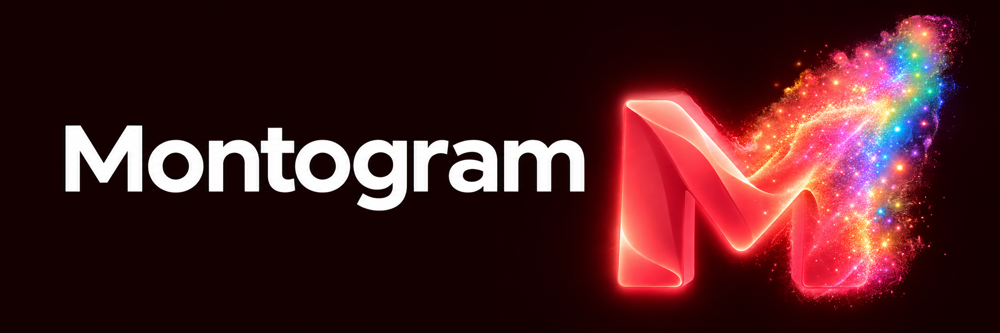

# Montogram

Независимый Android-клиент на открытой основе Telegram. Привычный интерфейс
по умолчанию, собственные инструменты и дополнительное оформление — по выбору.

**Проект в стадии alpha. Новый APK ещё не опубликован.** Логотип, значок
создателя и последние изменения интерфейса пока находятся в исходниках.
Это не официальный продукт Telegram.

## Возможности

| Направление | Что добавляется | Статус |
|---|---|---|
| Оформление | Компоненты Material 3, варианты аватаров и плотности | Частично реализовано; MD3 включается отдельно |
| Локальные данные | Собственные заметки, закладки-ссылки и шаблоны ответов | Базовые реализации есть; последние UI-правки ещё не в APK |
| Работа с текстом | Статистика, невидимые символы, RU/EN-раскладка | Исходники и целевые проверки; Android-проверка ожидается |
| Поиск | Поиск локальных заметок и ранжирование шаблонов | Исходники; Android-проверка ожидается |
| Защита от случайных действий | Подтверждение звонков и части отправок, preview голосового | Контексты покрыты частично |
| Идентичность проекта | Красная M и отдельный значок создателя Montogram | Новое оформление подготовлено; сборка ожидается |

Цель следующего полного этапа — **не менее 60 самостоятельных функций**.
План, исходники, успешная компиляция и проверка на устройстве отмечаются
раздельно. Количество кнопок и цветовых вариантов не выдаётся за число функций.

## Где APK

Готовая проверенная alpha появится во вкладке **Releases** вместе с SHA-256,
соответствующими полными исходниками, инструкцией сборки и списком ограничений.
Пока новый релиз отсутствует, не считайте последние исходники готовой APK.
Историческая внутренняя сборка20048 не включает новое оформление и свежие правки.

## Как устроены настройки

Обычный Telegram остаётся исходным режимом. Дополнительные настройки находятся
в разделе Montogram. Material 3 и собственные изменения поведения включаются
явно. Изменения оформления не дают Telegram Premium или новых серверных прав.

Локальные заметки, закладки и шаблоны привязаны к аккаунту. По умолчанию они
живут в текущем процессе; постоянное шифрованное хранение выбирается отдельно.
Перед использованием alpha прочитайте ограничения конкретного релиза.

## Сборка и участие

- [Сборка](BUILDING.md)
- [Изменения и текущая alpha](CHANGELOG.md)
- [Участие в разработке](CONTRIBUTING.md)
- [Сообщить об уязвимости](SECURITY.md)
- [Лицензия](LICENSE)

Основа — [Telegram Android](https://github.com/DrKLO/Telegram). Уведомления об
авторстве и лицензии исходного проекта и зависимостей сохраняются.

## Создатель

[@gimmextraligma](https://t.me/gimmextraligma), Telegram ID `5672308380`.
В Montogram для этого числового ID предусмотрен отдельный значок M.
Он обозначает роль в проекте Montogram и не заменяет верификацию Telegram.

## Визуальный стиль

Красная M с чётким основанием и постепенным переходом вверх-вправо в радужные
светящиеся частицы. Баннер и основной знак подготовлены специально для проекта.
Изображённые частицы — статичная графика; приложение не запускает ради них
постоянную анимацию или фоновый сервис.
